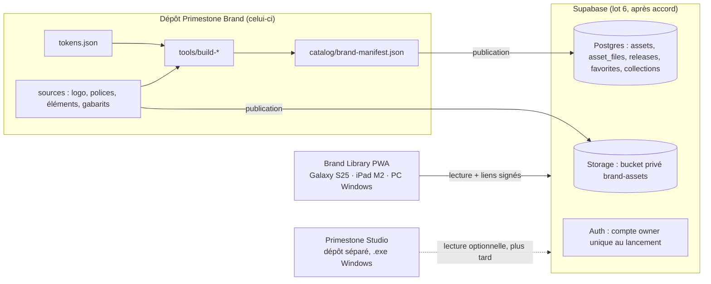

# Architecture

## Deux dépôts indépendants

- **Git** : code, tokens, SVG et PNG légers (environ 3,5 Mo au total). Aucun fichier lourd ni vidéo.
- **Supabase Storage** : tous les fichiers distribués, y compris les plus lourds (exports haute définition, vidéos). La clé de chaque fichier est son chemin dans le dépôt (`brand/04_elements/svg/PS_EL_incision_jaune.svg`), ce qui rend la publication idempotente.
- **Supabase Postgres** : catalogue, versions, favoris et collections. Schéma : `supabase/migrations/` (brouillon).

## Brand Library (lot 6)

| Besoin | Choix |
|---|---|
| Une seule application pour Android, iPad, Windows | PWA installable (Chrome Android, Safari iPadOS, Chrome ou Edge Windows) |
| Code | Vite + TypeScript, sans framework lourd ; interface adaptée de 360 px à l'écran de bureau |
| Recherche | Index local construit à partir du manifeste (titre, catégorie, tags, statut), instantané et hors ligne |
| Prévisualisation | PNG 1x ou SVG désignés par `preview` dans le manifeste |
| Téléchargement | Liens signés Supabase de courte durée (5 min) ; lots en ZIP côté appareil |
| Favoris, collections | Tables `favorites`, `collections`, propres à chaque compte |
| Versions | Table `releases` : un manifeste complet par version, notes de version, comparaison entre deux versions |
| Hors ligne | Service worker : interface, manifeste, tokens, logos, éléments et polices (quelques Mo). Les PSD et vidéos restent en ligne |
| Accès | Connexion par lien e-mail, inscription publique désactivée, un compte `owner` au lancement. Rôles `editor` et `viewer` prévus dans le schéma, sans interface d'équipe en v1 |

### Hébergement de prévisualisation

**Cloudflare Pages** est recommandé : forfait gratuit sans plafond de bande passante et URL de prévisualisation `*.pages.dev`. Le forfait gratuit Hobby de Vercel est réservé à un usage personnel non commercial, ce qui ne correspond pas à un média. Aucun domaine n'est nécessaire au départ.

### Publication (outil prévu au lot 6)

`tools/publish.mjs` comparera les empreintes SHA-256 du manifeste à celles de `asset_files`, n'enverra que les fichiers nouveaux ou modifiés, puis enregistrera une ligne dans `releases`. Il utilisera une clé de service gardée dans un fichier `.env` local, jamais commité.

### Quotas

Priorité au forfait gratuit. Les limites (stockage, taille par fichier, bande passante) sont à relever sur la page de facturation au moment de la création du projet ; le bucket est déjà limité à 50 Mo par fichier. `npm run build:manifest` affiche le volume total : il sera comparé au quota avant chaque publication. Aucun passage à un forfait payant sans accord.

## Sécurité

- Bucket privé : aucun fichier accessible sans compte membre.
- RLS activée sur toutes les tables ; écriture du catalogue réservée au rôle `owner`.
- Clés de service uniquement en local (`.env` ignoré par Git) ou dans les secrets de l'hébergeur.
- Les illustrations sous droits des éditeurs restent dans `brand/99_tests/client/`, ignoré par Git et jamais publié.
